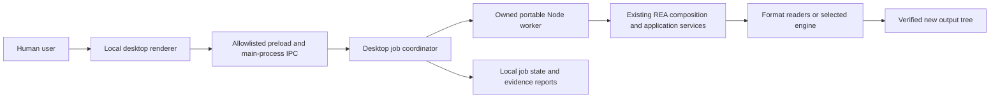

# Engineering overview

## System and boundaries

The existing [architecture diagram](architecture.mermaid), [tool-design guidance](tool-design.md) and [instruction file](../AGENTS.md) own REA's architectural rules: domain contracts point inward, providers own format/process interpretation, shared application workflows preserve evidence and typed failures, and CLI/MCP are outer adapters.

The desktop prototype adds another outer adapter:

The renderer is local content with context isolation, sandboxing and no Node integration. [Preload](../desktop/preload.cjs) exposes named actions instead of raw IPC. [Main](../desktop/main.mjs) validates its window sender, denies new windows/navigation/permissions and uses a constrained custom protocol. [Engine](../desktop/engine.mjs) owns selected-source metadata, job records and worker processes; [worker](../desktop/worker.mjs) calls the existing REA services. A job remains owned through worker/stream closure and report persistence. These controls and the limited runtime assertions do not establish completed security validation.

The entry module registers a readiness callback and finishes evaluating before Electron emits `ready`. The portable Node worker and Electron exchange JSON evidence, avoiding version-specific V8 binary serialization. The real desktop regression exercises both boundaries.

## Process lifecycle

The desktop launcher, one-command CLI and MCP transport are separate entry points. Reading documentation or source files does not instantiate any of them. The desktop coordinator forks a worker for an analysis; it owns that worker through stream closure and result persistence. Closing a window with an active job offers cancellation and waits for cleanup. These statements come from source inspection and retained tests; this review did not launch the application.

Codex's persistent personal MCP registration is intentionally disabled. An already-running host can retain an earlier enabled connection even after the saved setting changes. [Operations](operations.md#run-only-when-requested) owns the on-demand policy, temporary-session cleanup and cached-connection procedure. The offline Python checker only reads documentation and local link targets; it does not import the REA runtime.

## Interfaces and source authority

- Public engine contracts: [source tool contracts](../src/contracts/toolContracts.ts), [MCP documentation](mcp-contracts.md), [error schema](error-contract.schema.json).
- Portable Samsung and Palm composition: [binary diagnostics](../src/composition/binaryDiagnostics.ts).
- Archive/native one-shot workflows: [direct analysis composition](../src/composition/directAnalysis.ts).
- Artifact identity and extraction results: [artifact graph schemas](../src/domain/artifactGraph.ts).
- Desktop events, supported actions and result projection: [engine](../desktop/engine.mjs) and [worker](../desktop/worker.mjs). These internal interfaces are provisional; do not treat them as a stable external API.

Keep schema, evidence identity, incomplete coverage and typed failures with their existing owners. Do not duplicate parser decisions in UI labels or turn a recorded hash into an authenticity/compatibility claim. Progress is indeterminate unless real engine measurements exist; the Figma timer is demonstration-only.

## Data and risk applicability

Persistent data includes selected source paths, filenames, output locations, hashes, reports and error details. These can contain personal or proprietary information. Keep them local in the application work area, do not commit them, and do not log ambient credentials or full user configuration. The desktop bridge uses an explicit child environment rather than persisting the ambient environment.

Source files are read as data. The GUI must not launch supplied EXEs, DLLs, scripts or firmware. Output trees are newly created; existing files are not replaced by extraction. Cancellation, source changes, full disk, reparse points, process exits and cleanup failure require real acceptance checks. Current coverage and gaps are in the [audit](documentation-audit.md); inspection of controls alone does not establish security or reliability.

File preflight compares device/inode, size and nanosecond modification/change metadata. Moved/changed originals disable historical re-extraction until selected again; old observations remain readable. This is a metadata check, not a cryptographic snapshot or a recursive directory-change guarantee. Reader contracts own the hashes and input/output verification for the bytes actually analyzed; race and storage-failure coverage must not be overstated.

There is no deployed cloud service, account/auth backend or schema migration in this GUI change. Native app/browser state and REA job files still require a documented backup/retention policy before a broader operational handoff. Deletion/retention ownership is unassigned; no automatic cleanup schedule is introduced.

## Decisions and operations

The [Electron-shell proposal](decisions/0001-desktop-shell.md) records alternatives and the compactness tradeoff. Desktop runtime files are separate portable dependencies under the application root, not source commits. [Operations](operations.md) defines the current launch/rollback boundary; the GUI is not yet promoted.
